# ENCORE — System Design

## Architecture
NodeHTTP localhost + SQLiteWALแบบเดิม; เพิ่มsales.mjsตรวจตารางรอบ/membergrant/contact; delivery.mjsสร้างQRและMIMEemailทดลองด้วยqrcode (ไม่ต่อproviderภายนอก)

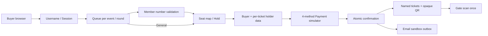

## Data / Migration
คงusers/sessions/events/holds/seats/payments/orders/tickets/refunds/notifications/auditเดิม
เพิ่มusers.username UNIQUE; queues.round; holds.roundและcheckoutJSON; payments.method; tickets.holderJSON โดยตรวจPRAGMAtable_infoก่อนALTER ไม่ล้างข้อมูลเดิม
เพิ่มmemberships(number,user,status,valid_until), sale_rounds(event,kind,start,end), member_grants(user,event,expires), mail_outbox(order_idUNIQUE,user,recipient,status,created)
Membershipstatusเป็นคนละส่วนกับloginaccount; registerไม่มีสิทธิ์ตั้งmemberหรือrole; seedมีfan/fan2/fan3ให้ทดสอบจริง

## Sale state
เก็บUTC แสดงAsia/Bangkok; NEONMember6พ.ย.10:00–ก่อน15:00 General15:00ถึงวันปิดงาน; roundอื่นMemberเริ่มตามsaleเดิม5ชม.แล้วGeneral
queueเปิดก่อนstart15นาทีแต่pumpเฉพาะstart<=now<end; active2/round/งาน; TTL900sclamproundend; numberจากseqไม่เปลี่ยน; ahead+ETAเป็นประมาณ ไม่ใช่SLA
Expiredqueueและholdถูกsweepก่อนทุกAPI; หน้ารอpoll2sอัตโนมัติ; catalogrefresh30sเมื่อไม่ได้เปิดbooking

## Member gate
1. loginแล้วjoinMember ต้องmembershipactiveและvalid_until>now ไม่ผ่าน403ข้อความตรง“ไม่ใช่สมาชิกMember”
2. ถึงคิวให้ส่งnumber; ตรวจaccountเป็นเจ้าของเลข/คิวactive/รอบเปิด
3. ตรวจถูกแล้วUIเรียกGETseatsและเข้าผังทันที ไม่แสดงsuccesspageและไม่ต้องกดปุ่มซ้ำ; grantผูกuser+event expires=min(queueexpires,roundend,membervaliduntil)
4. GETmapและPOSTholdตรวจgrantซ้ำที่server; ลิงก์ตรงหรือแก้JavaScriptข้ามไม่ได้
5. Generalไม่ต้องกรอกnumberแต่ต้องactivequeueก่อนhold

## Hold / Checkout / Money
BEGINIMMEDIATEทำholdatomicทั้งbasket; Memberboughtยังไม่refunded+holdใหม่<=2; globalทุกround<=4; หนึ่งactivebasketต่อaccount
holdexpires=min(now600s,roundend,MembervalidUntil); ไม่ยืดด้วยUI; checkoutเฉพาะheldเก็บsnapshotbuyerและholdersที่จับคู่seatครบ; pending/paidแก้ไม่ได้
สูตรเงินบาทเต็มเดิมและallocationรายใบคงเดิม; อ้างTEST-DATAค่าคงที่

## Payment and email
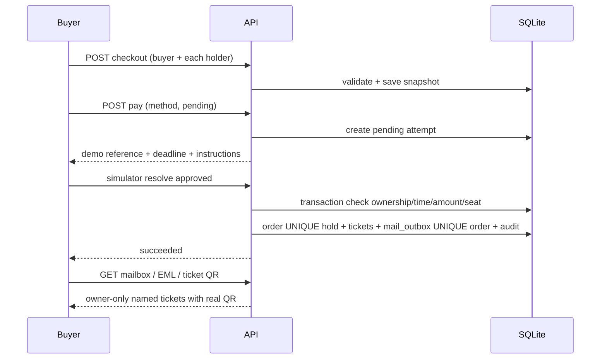
qrcodeสร้างSVG/PNG encode256bittoken ไม่ใส่ชื่อ/email/phoneในpayload ชื่ออยู่บนบัตรและemailhtml
QRชำระencodeENCORE-DEMO-PAY:paymentId ไม่ใช่PromptPayเงินจริง; CreditCardไม่รับPAN/CVVจริง; Counterมีรหัสทดลองและdeadlineเท่าhold
เงินมาช้าใช้grace120sเดิม -> auto_refundedไม่มีorder/ticket/email ไม่แย่งseatที่คืนแล้ว; failedretryใช้attemptใหม่; terminalcallback/replayไม่ส่งซ้ำ
Outboxเป็นlocalinbox ไม่มีSMTP/networkออก ข้อความemailมีbuyerrecipientและticketทุกใบ สร้าง.emlmultipart/relatedพร้อมQRPNGที่อ่านได้ เหมาะกับโหมดที่ผู้ใช้เลือก

## Legacy and invariants
รายการที่ holder=NULL ต้องแสดงตามข้อมูลที่มี ไม่สร้างชื่อผู้ถือหรืออีเมลย้อนหลังเมื่อไม่มีข้อมูลผู้ซื้อ การปรับ schema ต้องรักษาข้อมูลในไฟล์ฐานข้อมูล encore-v2.sqlite ซึ่งเป็นชื่อไฟล์ที่ระบบใช้งาน
Owner-onlyทุกQR/mail/payment; escapePIIในHTML; session/token/passwordprotectionsเดิม; refund/scan/cancelยังใช้transactionและสถานะเดิม
ไม่ใช่ระบบรับเงินจริง/ส่งemailจริง ไม่มีproviderwebhook/กล้องอ่านQRในเว็บ (นำpayloadที่อ่านจากQRมากรอกscanner); decoderทดสอบอิสระด้วยjsQR

## Docker Compose
Dockerfileใช้Node22slim ติดตั้งเฉพาะruntime dependenciesแล้วรันเป็นnodeuid1000; APIรองรับHOSTenv (default127.0.0.1บนเครื่อง และ0.0.0.0ในcontainer)
compose.yamlเปิด127.0.0.1:4310→4310และnamedvolumeencore-dataเก็บSQLite/WAL; healthcheckใช้Nodefetchไม่ต้องติดตั้งcurl
.dockerignoreกันฐานข้อมูล/secrets/dependencies/ผลทดสอบ/ภาพอ้างอิงไม่เข้าbuildcontext; defaultไม่เปิดtesttools; LIVE_CLOCK0เป็นdemoและปรับได้
การทดสอบจริงและขอบเขตดูDOCKER-VERIFICATION.md

## Account-specific catalog / theme
GETeventsระบุschedule/saleRound/status/limitตามregistryของbuyer: activeMember→Member Sale, General→General Sale; public/organizerยังเห็นสองรอบ ข้อมูลอื่นจากaccountไม่ปะปนและGeneralAPIgateยังบังคับmemberstatus
UIโหลดcatalogใหม่เมื่อlogin/logout แสดงaudienceชัดและมีdemoaccountgeneralแยก เฟรมเว็บเป็นพื้นสว่าง แถบ/ปุ่มฟ้านุ่ม รูปposterคงสีแต่ลดความจัด

## แผนภาพเพิ่มเติมตาม LAB 3
Node + SQLite ในcontainerเดียวเป็นadaptationตามระบบที่มีอยู่ ไม่เพิ่มPostgreSQLเพื่อเลียนแบบสปา ไฟล์SQLอยู่db/schema.sql

### architecture

[Mermaid source](design/architecture.mmd)
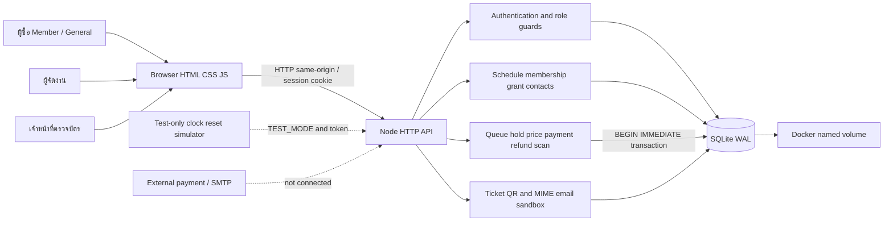

### use-cases

[Mermaid source](design/use-cases.mmd)
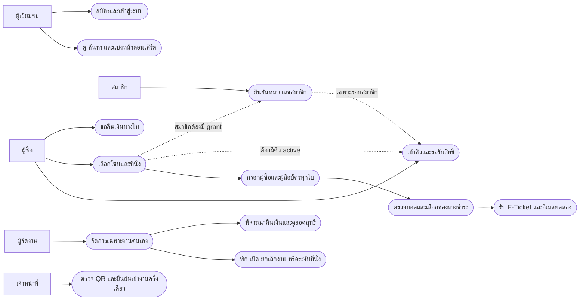

### booking-flow

[Mermaid source](design/booking-flow.mmd)
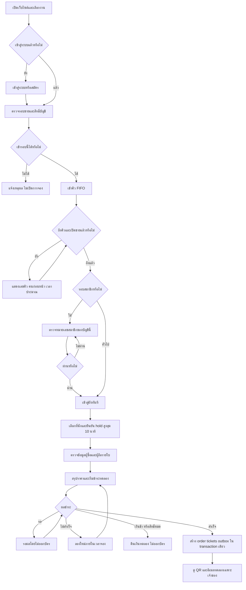

### erd

[Mermaid source](design/erd.mmd)
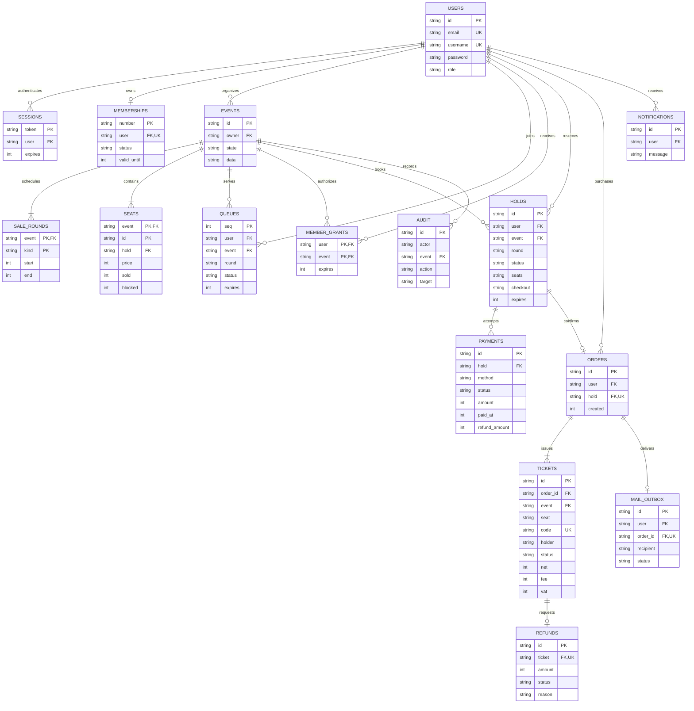

### payment-sequence
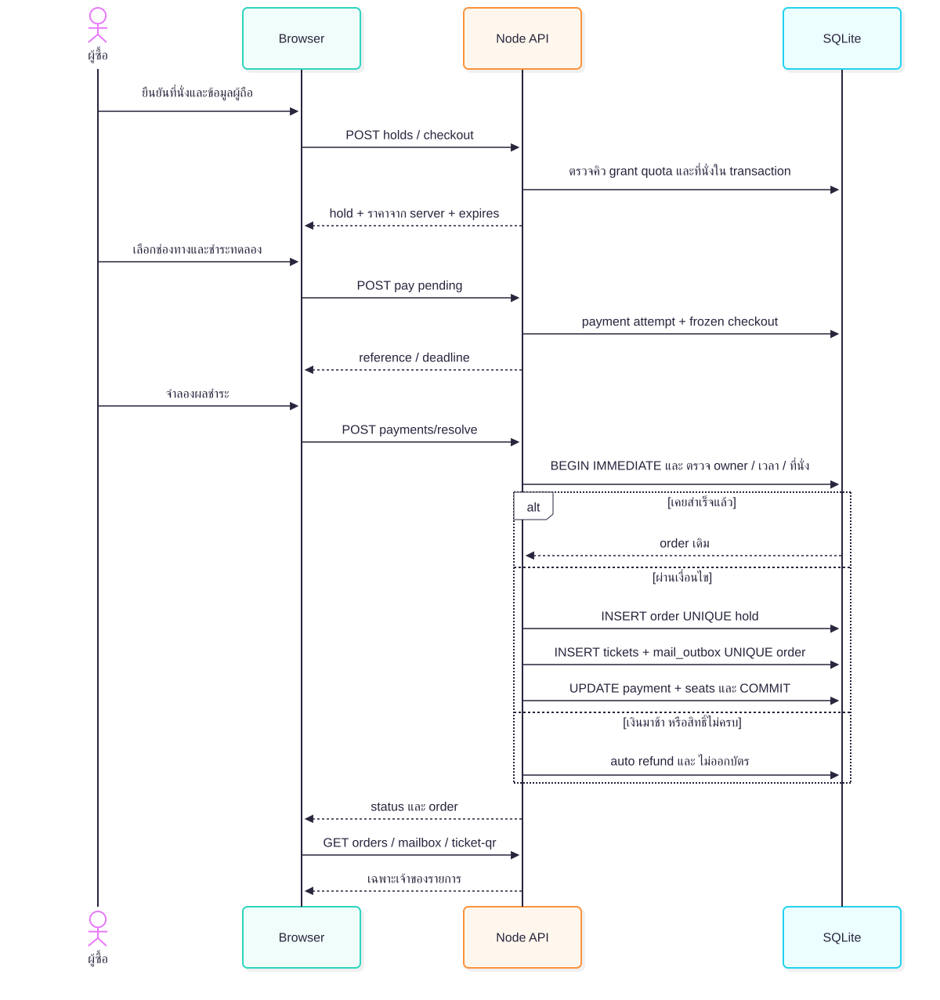

[Mermaid source](design/payment-sequence.mmd)
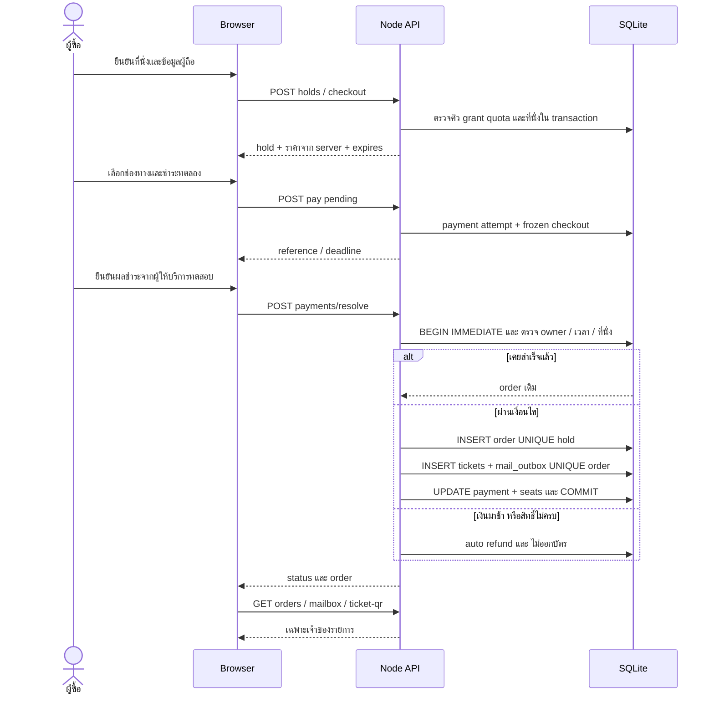

### seat-race-sequence
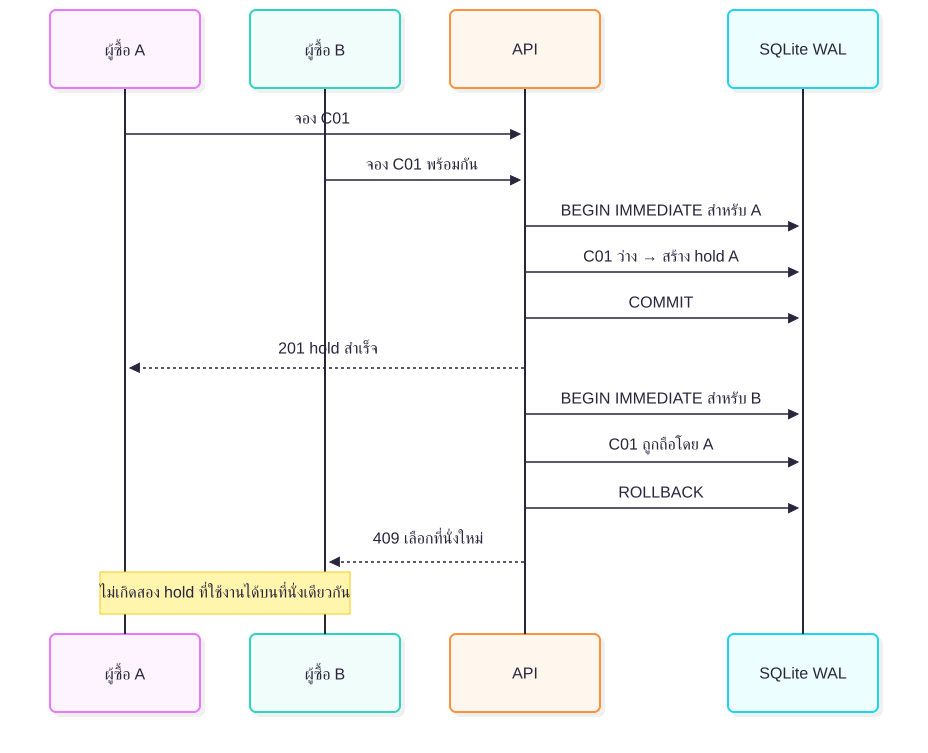

[Mermaid source](design/seat-race-sequence.mmd)
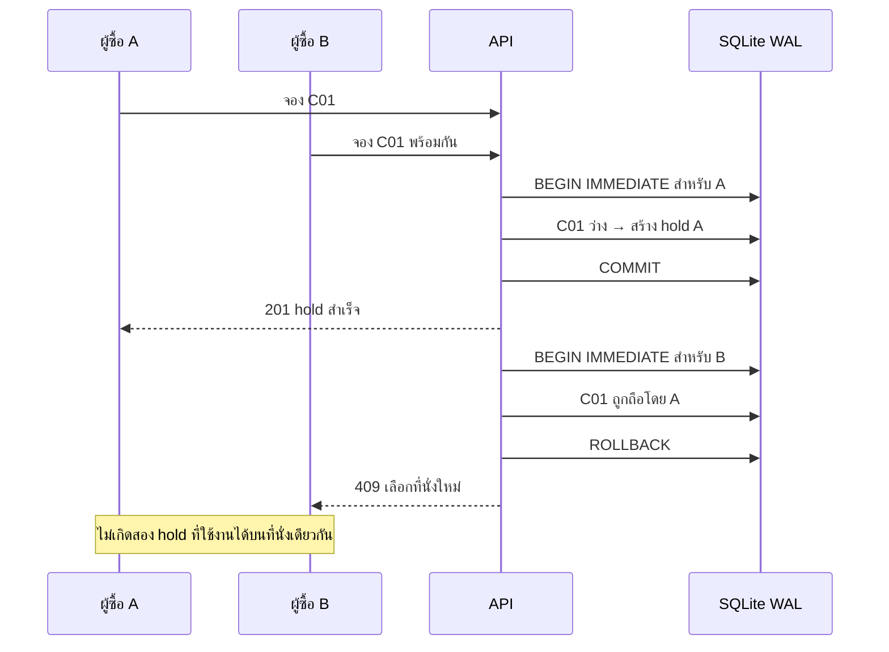

holds.seats/checkoutและtickets.holderเป็นJSONsnapshot ไม่ใช่FKแยกรายที่นั่ง; failures/attemptsบันทึกชื่อที่ไม่มีบัญชีได้จึงไม่ผูกusersFK
