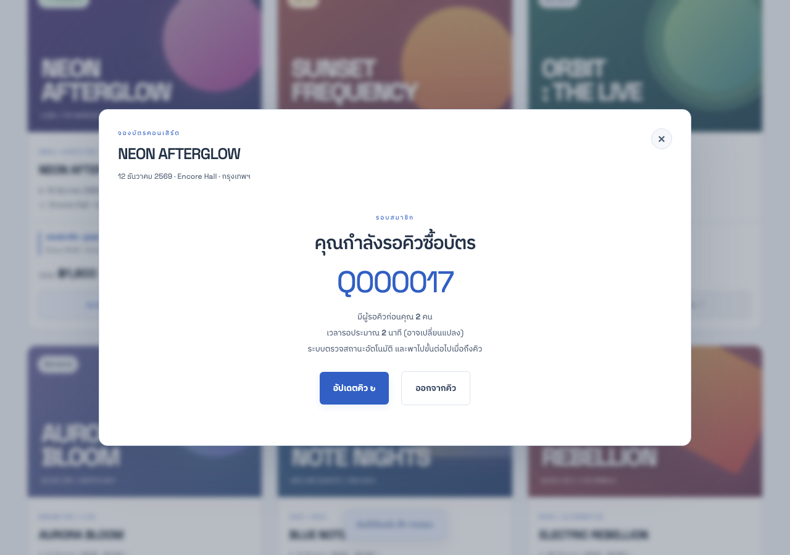
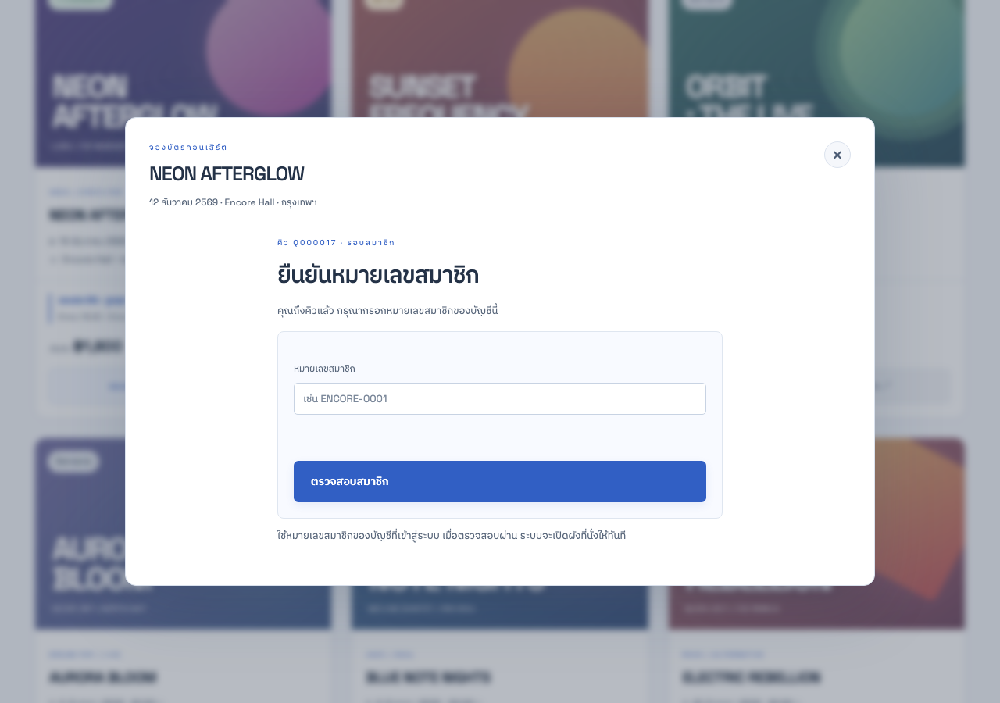

# C2 — สำรวจเวลาเปิดขายและคิวแบบไม่อ่านโค้ด

ผู้สำรวจ: agent `/root/explore_c2` แยกจากผู้พัฒนา/ผู้เขียนรายงานรวม

- เริ่ม UTC: 2026-11-06T11:12:41.442Z
- สิ้นสุด UTC: 2026-11-06T11:12:46.398Z
- ระบบที่ใช้: http://127.0.0.1:4342 · ฐานข้อมูลในหน่วยความจำเฉพาะ C2 · BUG_MODE 0
- อ่านเฉพาะ REQUIREMENTS.md, TEST-DATA.md, web/SPEC.md และ web/ASSETS.md ไม่เปิด runtime source หรือ web/BUGS.md
- ไม่เรียกพอร์ต 4310, 4311, 4312 หรือเซิร์ฟเวอร์ของ charter อื่น
- ผล: **9/9 ผ่านตาม oracle ที่กำหนดก่อนเปิดระบบ** ไม่พบบั๊กพฤติกรรมในกรณีที่สำรวจ

## ฟังข้อกำหนด [D]

REQUIREMENTS.md BR02/03/04/06/07/09 และ TEST-DATA.md เป็น expected: NEON Member เปิด 10:00 ถึงก่อน 15:00 น.; General เปิด 15:00 น.; ห้องรอเปิดก่อนรอบ 15 นาที; active สูงสุด 2 บัญชี; หมายเลขไม่เปลี่ยน; ahead รวมคน active และ waiting ก่อนตน; ETA เป็นค่าประมาณ; queue TTL 900 วินาที; hold ไม่เกินเวลาจบรอบ

[D] เป็นป้ายของหลักฐานข้อกำหนดสำหรับการสำรวจนี้ ไม่ได้เปลี่ยนรายละเอียดเดิมที่ REQUIREMENTS.md แยกที่มา U/A/R ไว้ กฎ active 2/TTL/สูตร ETA เป็นสมมติฐาน ENCORE ที่ตกลงบันทึก ไม่ใช่นโยบายทั่วไปของเว็บขายบัตรภายนอก

## ฟังคำอ้างผู้สร้าง [A]

web/SPEC.md อ้างว่ามี fixed number/ahead/ETA, schedule 10/15, grant ก่อนผัง และเข้าผังทันทีหลังตรวจสมาชิก ส่วน web/ASSETS.md แยกภาพอ้างอิงจากภาพระบบและระบุหน้าจอปัจจุบันเป็นธีมสว่าง คำอ้างเหล่านี้ใช้เป็นสิ่งที่ต้องสังเกต ไม่ใช้เป็นต้นทางตัวเลข expected แทน [D]

## เปรียบเทียบ [D] / [A] / [O]

| Case | กฎจาก [D] | คำอ้าง [A] ที่เกี่ยวข้อง | สิ่งที่สังเกตจริง [O] | ผล |
| --- | --- | --- | --- | --- |
| C2-01 | BR03/04 ก่อนห้องรอ 09:45 เข้าไม่ได้ | schedule / queue | 09:44:59.999 POST queue Member ได้ 409 SALE_UNAVAILABLE | ตรง |
| C2-02 | BR04/06 ตรง 09:45 รอจนถึงขายและเลขคงที่ | fixednumber/ETA | waiting, ETA 900 วินาที, อ่านซ้ำหมายเลขเดิม; verify ก่อนถึงคิวได้ 403 | ตรง |
| C2-03 | BR03/04 ต้องไม่ active ก่อน 10:00 | scheduled admission | 09:59:59.999 ยัง waiting; อ่านผังไม่ได้ 403 | ตรง |
| C2-04 | BR03/04/07 ตรง 10:00 active แล้วจึงตรวจเลขเข้าผัง | grant-before-map | 10:00 active, หมายเลขเดิม; verify 200 และ seats 200 | ตรง |
| C2-05 | BR06/FR04/05 active 2 คน ผู้ซื้อคนที่สามรอ FIFO | fixednumber/ahead/ETA/polling | fan/fan2 active; fan3 Q000017 waiting/ahead 2/ETA 120; reload เลขเดิม; fan ออกคิวแล้ว browser fan3 แสดงหน้าหมายเลขสมาชิกอัตโนมัติ เลข Q000017 เดิม | ตรง |
| C2-06 | BR02/03/09 hold ก่อน 15:00 ต้องจบไม่เกิน 15:00; Member ปิด/General เปิด | schedule10/15 | hold ที่ 14:59:59.999 หมดอายุ 15:00; ตรง 15:00 hold หาย, Member join 409; General active/catalog available/seats 200 | ตรง |
| C2-07 | BR06/07 TTL 900s และ grant สิ้นสุดตามคิว | grant expiry | 10:14:59.999 อ่านผัง 200; 10:15 คิว expired และอ่านผัง 403 | ตรง |
| C2-08 | BR04/05 General เข้าห้องรอตรง 14:45 แต่ห้าม Member | eligible/schedule | 14:44:59.999 General join 409; 14:45 waiting/ETA 900; บังคับ Member ได้ 403 | ตรง |
| C2-09 | BR03/04 ตรงปิด General 12 ธ.ค. 17:00 ห้ามรับใหม่ | round schedule | 16:59:59.999 active; 17:00 join 409 และ catalog closed | ตรง |

## หลักฐานเบราว์เซอร์

ภาพต่อไปนี้จับจาก browser context ของ fan3 ที่แยกจาก fan/fan2 จึงไม่ได้อนุมานผลจาก response อย่างเดียว

- [ผลดิบและ response ที่สังเกต](c2/observations.json) มีเวลาเริ่ม–จบของแต่ละ case และคำขอ 47 ครั้ง
- [สคริปต์ทำซ้ำ](c2/run.mjs) ใช้ browser และ HTTP public/test endpoints ไม่อ่านไฟล์ฐานข้อมูลหรือโค้ดระบบ
- [ผลรอบเตรียมเครื่องมือ](c2/attempt-1.json): browser request ใช้ relative URL โดยไม่มี baseURL จึงเกิด Invalid URL เฉพาะ harness ไม่ใช่ข้อผิดพลาดของระบบ แก้ให้ URL เต็มแล้วรัน 9 กรณีใหม่ทั้งหมดโดยไม่เปลี่ยน expected

## กติกาและบันทึกการเปลี่ยนข้อมูล

เฉพาะ C2 เป็นเจ้าของนาฬิกา/reset ของพอร์ต 4342 ทั้งหมด บัญชี fan/fan2/fan3/general ของเซิร์ฟเวอร์นี้ไม่ปะปนกับ charter อื่น มี reset 9 ครั้งและ clock 7 ครั้ง รวม 16 รายการ บันทึกเวลาจริง UTC เวลาจำลองที่ตั้ง และ HTTP status ของทุกการเปลี่ยนไว้ใน controls ของ observations.json

การใช้ฐานข้อมูลแยกทำให้ปรับเวลาเป็นอดีต/อนาคตได้โดยไม่ทำให้ agent อื่นสูญเสียคิวหรือ session เฉพาะ C2-05 ใช้สามบัญชีร่วมเซิร์ฟเวอร์โดยตั้งใจเพื่อพิสูจน์ FIFO ภายใน charter

## ประเด็นส่งต่อและขอบเขต

1. [ส่งต่อ C1/ผู้เขียนเอกสาร] SPEC ใช้คำรวมว่าแสดงสอง sale windows แต่ข้อกำหนดปัจจุบันแยกตามบัญชี ควรระบุว่าผู้เยี่ยมชม/ผู้จัดเห็นภาพรวม ส่วน Member/General เห็นรอบของตน เพื่อไม่ให้ writer ยึดข้อความรวมเป็น expected ของทุกบัญชี
2. [ส่งต่อ C3/C4] C2 ตรวจ hold หนึ่งใบเพื่อพิสูจน์การ clamp เวลาเท่านั้น ไม่อ้างว่าตรวจ quota หรือสูตรเงินทั้งหมด
3. [ยังไม่ยืนยัน] ผลนี้ตรวจ 3 ผู้ซื้อพร้อมกันและขอบเวลาที่กำหนด ไม่ใช่โหลดระดับงานจริง ความแม่นยำ ETA หรือความยุติธรรมเมื่อหลายเครื่องเครือข่ายช้าแตกต่างกัน
4. [ส่งต่อ C7] การทดสอบคิวหมดอายุและปิดรอบของ C2 ทำเฉพาะเซิร์ฟเวอร์ C2 แล้ว C7 ยังต้องตรวจ regression ปิดท้ายของตนเองหลัง C1–C6 จบ
