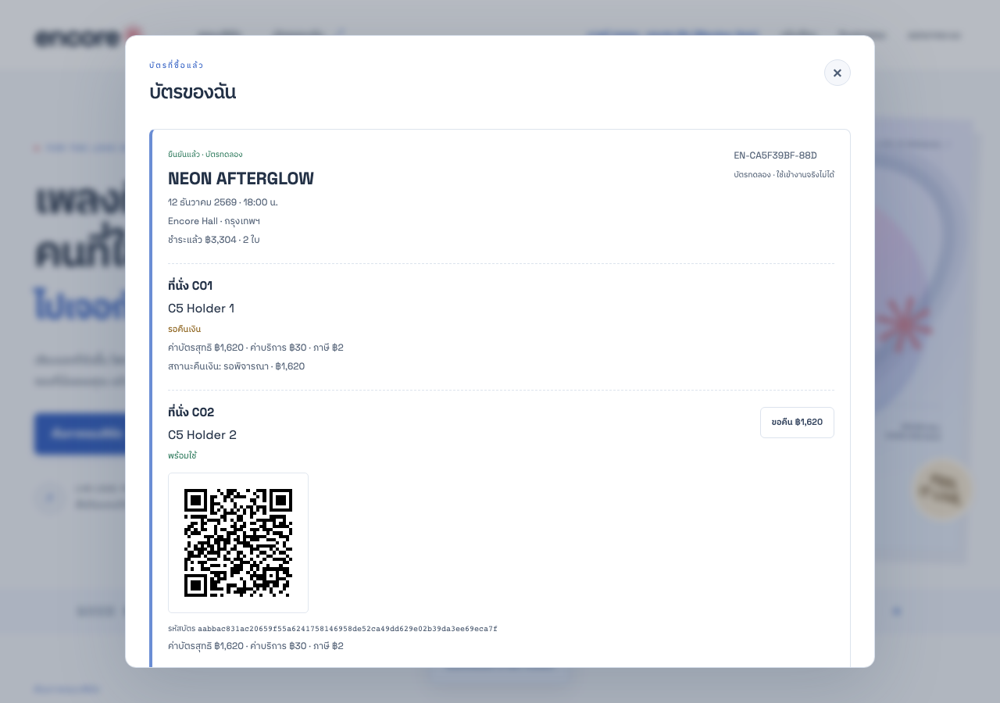
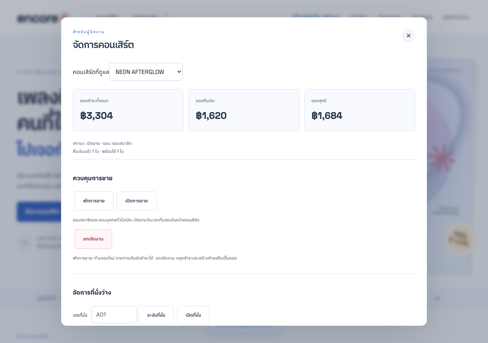

# C5 — คืนเงิน ผู้จัดงาน และตรวจบัตร แบบไม่อ่านโค้ด

ผู้สำรวจ: agent `/root/explore_c2` รับ charter C5 ในรอบที่สองหลังส่งผล C2 แล้ว ไม่มีการแก้หลักฐาน C2

- เริ่ม UTC: 2026-11-06T11:17:41.295Z
- สิ้นสุด UTC: 2026-11-06T11:17:44.960Z
- เซิร์ฟเวอร์: http://127.0.0.1:4345 · ฐานข้อมูลในหน่วยความจำเฉพาะ C5 · โหมดปกติตาม ENVIRONMENT.json
- อ่านเฉพาะ REQUIREMENTS.md, USER-STORIES.md, TEST-DATA.md, web/SPEC.md และ web/ASSETS.md ไม่อ่าน runtime source, ฐานข้อมูล หรือ web/BUGS.md
- ไม่เรียกเซิร์ฟเวอร์ผู้ใช้ 4310 หรือพอร์ตของ charter อื่น

## ผลรวมและความหมาย

สำรวจ 9 กรณี: **8 กรณีที่มีข้อกำหนดรองรับผ่าน และ 1 กรณีบันทึกเป็น observed-unconfirmed เพื่อให้ผู้ตัดสินตรวจ oracle** ไม่มีกรณีที่พบผลขัดข้อกำหนดโดยยืนยันได้

คำว่า passed ของ C5-03/04/08 หมายถึงส่วนที่มี assertion ตาม [D] ผ่าน ส่วนประเด็นย่อยที่เอกสารยังไม่ชัดยังติดป้ายแยก ไม่ได้นับเป็นการยืนยันนโยบายย้อนหลังจากสิ่งที่เว็บแสดง

## ฟังข้อกำหนด [D]

- REQUIREMENTS.md FR07/16/17: ที่นั่งระงับซื้อไม่ได้ สิทธิ์ผู้จัดต้องแยกตามเจ้าของงาน บัตรใช้เข้างานได้ครั้งเดียว บัตรคืนแล้วหรือรอคืนใช้เข้างานไม่ได้
- USER-STORIES.md US15/16: เจ้าหน้าที่เห็นชื่อผู้ถือ และเจ้าของงานจัดการ pause/block/cancel/refund/audit ได้
- TEST-DATA.md: Regular C01+C02 กับ STAGE10 รวม 3,304 บาท ค่าบัตรสุทธิรายใบ 1,620 บาท คืนหนึ่งใบเหลือยอดสุทธิ 1,684 บาท โดยไม่คืน fee 30/VAT 2 ของใบนั้น
- TEST-DATA.md: refund 72h; ประตู NEON วันที่ 12 ธ.ค. 2569 เวลา 16:00 ถึงก่อน 22:00 น.

[D] ในรายงานนี้หมายถึงเอกสารข้อกำหนดที่ใช้เป็น oracle ไม่ได้ยกระดับกฎที่เดิมติด [A] เป็นคำตอบผู้ใช้จริง รายละเอียดใดไม่ได้เขียนชัดจะไม่ถือว่าระบบถูกเพียงเพราะพบผลเช่นนั้น

## ฟังคำอ้างผู้สร้าง [A]

SPEC อ้างว่ามี refund/scan/cancel แบบ transaction และ owner-only endpoints, ได้ชื่อผู้ถือจากการตรวจบัตร รวมถึงข้อความภาษาไทยบนหน้าจอ แต่ไม่ได้อธิบายนโยบายคืนเต็มจากการยกเลิกงาน การขอคืนซ้ำหลังถูกปฏิเสธ และผลชำระของ hold เดิมเมื่อพักขายให้ละเอียดพอเป็น oracle แยกจากการสังเกต

## เปรียบเทียบ [D]/[A]/[O]

| Case | Expected ที่ตั้งก่อนสังเกต | ผลจริง [O] | ข้อสรุป |
| --- | --- | --- | --- |
| C5-01 | FR17 ผู้ซื้อและผู้จัดต่างงานห้ามจัดการ NEON | buyer admin 403; SKY อ่านยอด/พักขาย/ระงับที่นั่ง NEON ได้ 403 ทุกจุด; ENCORE dashboard 200 | ผ่าน [D] |
| C5-02 | FR07/17 blocked ไม่ให้ซื้อ และไม่แก้ที่นั่งที่กำลังถูกถือ | C01 blocked แล้ว hold 409; เปิดกลับ hold 201; ระงับ C01 ที่ถูกถือได้ 409 | ผ่าน [D] |
| C5-03 | BR12 และ TEST-DATA: 3,304 − 1,620 = 1,684 บาท | ผู้ซื้อเห็น C01 รอคืนและ C02 พร้อมใช้; ผู้จัดอนุมัติแล้ว gross3,304/refund1,620/net1,684; อนุมัติซ้ำยังมี refund เดียว; ticket refunded/valid อย่างละใบ | เงินตรง [D]; การอนุมัติซ้ำต้องเขียนนโยบายให้ชัดเพิ่ม |
| C5-04 | TEST-DATA: ก่อน 72h ขอคืนได้ หลัง 72h ไม่ได้ | ก่อนขอบ1ms 201; หลังขอบ1ms 409; ตรงขอบ72h ได้201 | ก่อน/หลังผ่าน [D]; ค่าตรงขอบยังต้องระบุ inclusivity ในเอกสาร |
| C5-05 | FR16 + gate fixture: ก่อน16:00ไม่ได้ ตรง16:00ได้ ตรง22:00ไม่ได้ | 15:59:59.999 GATE_CLOSED; 16:00 ผ่าน200/ชื่อ C5 Holder1; 22:00 GATE_CLOSED; 21:59:59.999 อีกใบผ่าน200 | ผ่าน [D] |
| C5-06 | FR16/BR17: บัตรหนึ่งใบใช้ได้ครั้งเดียวและต้องถูกบทบาท/งาน | สแกนพร้อมกันสองคำขอได้200/409; buyer403, ผิดงาน403, รหัสไม่รู้จัก404 | ผ่าน [D] |
| C5-07 | FR16 บัตรคืนแล้วและรอคืนห้ามผ่านประตู | คืนแล้วและรอคืนได้409 TICKET_STATE ทั้งสองใบ | ผ่าน [D] |
| C5-08 | FR17 พักขายต้องไม่รับซื้อใหม่; ทดลองสังเกต hold เดิมแยกต่างหาก | hold ใหม่409, joinใหม่409; hold ที่มีอยู่ก่อนพักยัง pay succeeded; เปิดขายกลับได้ | ส่วนห้ามซื้อใหม่ผ่าน [D]; การจ่าย hold เดิมยังต้องยืนยันนโยบาย |
| C5-09 | ไม่ตั้ง detailed expected จาก SPEC กว้าง ๆ; สังเกตเพื่อนำส่งผู้ตัดสิน | reject→valid; ขอใหม่ใช้ refund ID เดิม; ยกเลิกงานเปลี่ยนยอดคืนจาก1,620เป็น1,652รวมfee/VAT; เปิดงานกลับ409 | observed-unconfirmed ไม่ใช้ผลนี้เป็น expected โดยอัตโนมัติ |

## ภาพหลักฐาน

- [ผลดิบ](c5/observations.json) มี request/response 107 คำขอ และเวลาเริ่ม–สิ้นสุดแต่ละกรณี
- [สคริปต์ทำซ้ำ](c5/run.mjs) ใช้ Playwright/browser และ public/test HTTP endpoints ไม่อ่าน implementation
- การเปลี่ยนข้อมูลทั้งหมดเกิดบนเซิร์ฟเวอร์ C5 เท่านั้น มี reset 9 ครั้งและ clock 9 ครั้ง รวม 18 รายการ บันทึก UTC/เวลาจำลอง/status ใน controls
- มีการเลื่อนนาฬิกากลับในกรณีขอบ72hและเวลาปิดประตูโดยตั้งใจ เพื่อทดสอบบัตรที่ยังไม่ถูกใช้ในแต่ละขอบ ไม่อ้างเป็นพฤติกรรมเวลาจริงของระบบใช้งาน

## ส่งต่อผู้ตัดสินและ writer

1. เพิ่มนโยบายเป็น [A] ที่ตกลงใช้ก่อนเขียน expected ว่า 72h รวมจุดตรงขอบหรือไม่ ปัจจุบันสังเกตว่าอนุญาตตรง72h
2. ยืนยันว่าการไม่อนุมัติคืนเงินคืนสิทธิ์บัตร และขอใหม่ได้อย่างไร ไม่ใช้ชื่อ status จากเว็บเป็น oracle เพียงอย่างเดียว
3. ยืนยันว่าการยกเลิกงานต้องคืนเต็มรวม fee/VAT และงานยกเลิกแล้วเปิดกลับไม่ได้หรือไม่ ปัจจุบันอยู่ใน FR17 แบบคำรวมเท่านั้น
4. ยืนยันว่าพักขายหมายถึงปิดรับรายการใหม่แต่รายการที่ hold ก่อนหน้าจ่ายได้หรือไม่ ข้อความ UI อธิบายเช่นนั้น แต่ข้อความ UI เป็น [O] ไม่ใช่ [D]
5. C5 ตรวจ concurrency ระดับสองคำขอสแกน ไม่ใช่ throughput ประตูหน้างานจริง ไม่ได้ใช้กล้องหรือเข้าเว็บผู้รับชำระจริง
