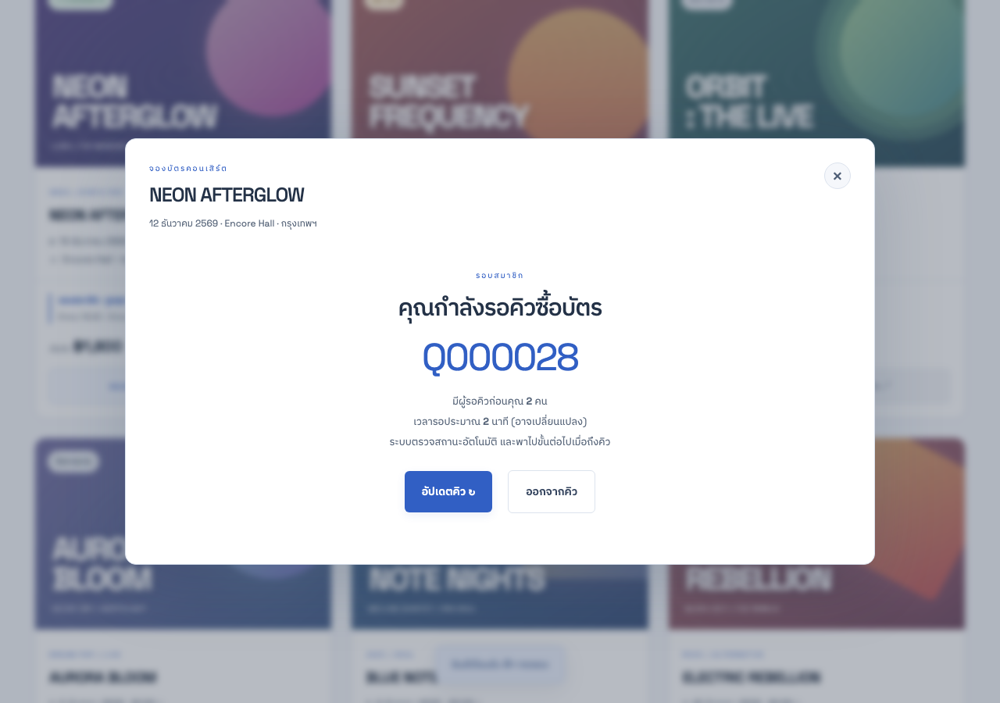
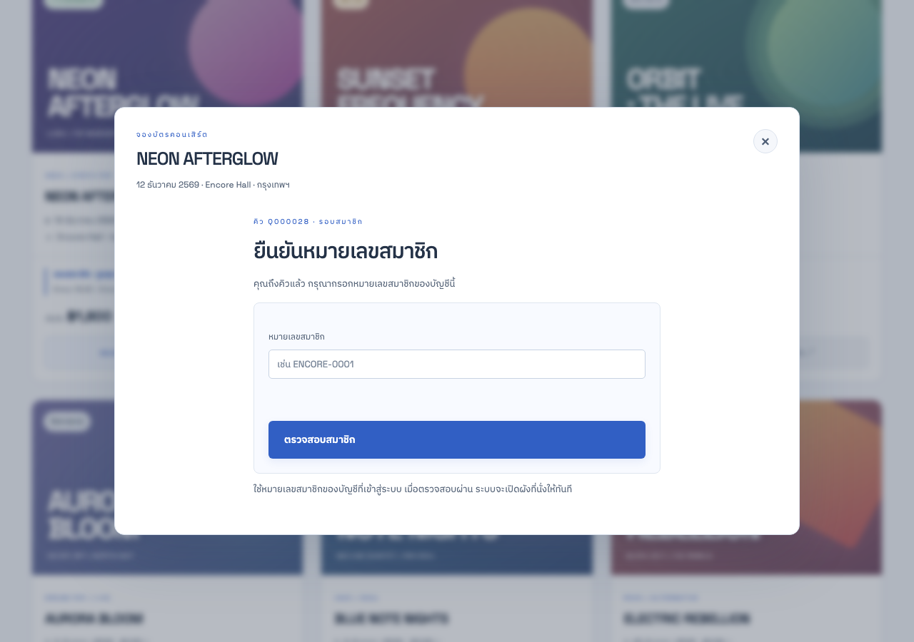
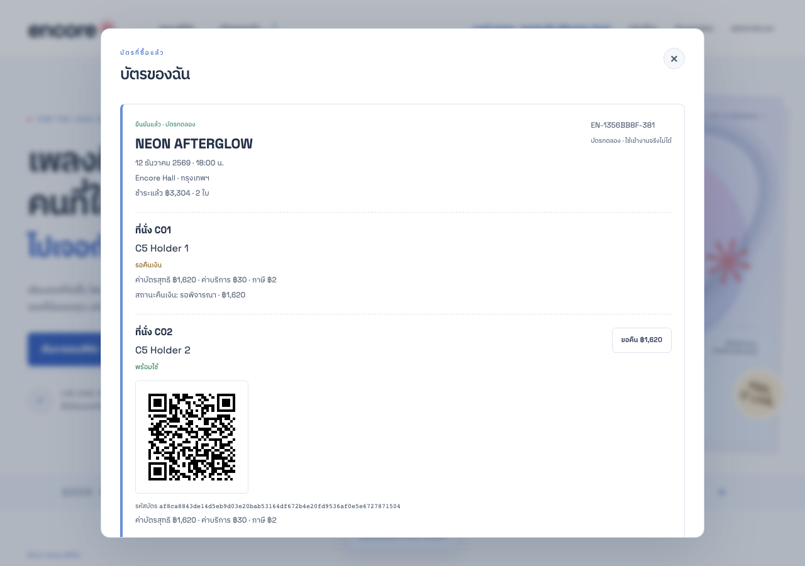
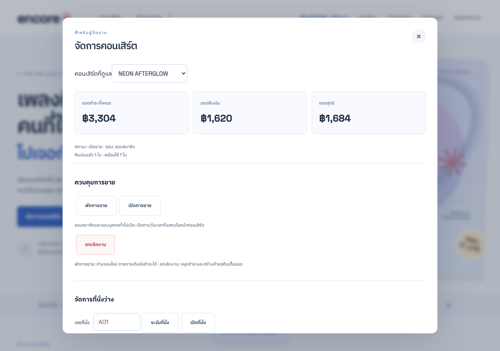

# Agent C2 — replay หลังแผน LAB7 และ reconnaissance

ผู้ปฏิบัติ: agent /root/explore_c2 รับ C2 และ C5 คนละเซิร์ฟเวอร์ ไม่อ่าน runtime source หรือ web/BUGS.md

## ลำดับจริง

1. อ่าน CHARTERS.md ฉบับขยาย และ exploration/lab8/recon.json ก่อนคัดลอกสคริปต์ replay ไม่อ้างว่าแผนฉบับนี้มาก่อนการสำรวจรอบแรก
2. Recon สิ้นสุด UTC 2026-11-06T11:22:22.386Z; อ่านแผน/เตรียม replay UTC 2026-11-06T11:43:00.686Z
3. reset เฉพาะพอร์ต 4342 ก่อนเริ่ม C2 และพอร์ต 4345 ก่อนเริ่ม C5 โดยใช้ test token ของ charter บันทึกไว้ใน agent-c2-preflight.json
4. C2 เริ่ม 2026-11-06T11:43:01.478Z สิ้นสุด 2026-11-06T11:43:08.065Z
5. C5 เริ่ม 2026-11-06T11:43:08.839Z สิ้นสุด 2026-11-06T11:43:13.731Z

## ผลรัน

| Charter | ระบบ | กรณี | ผ่านตาม assertion เดิม | รอ oracle ตามป้ายเดิม | HTTP observations | Reset/clock ในสคริปต์ |
| --- | --- | ---: | ---: | ---: | ---: | ---: |
| C2 | http://127.0.0.1:4342 | 9 | 9 | 0 | 47 | 16 |
| C5 | http://127.0.0.1:4345 | 9 | 8 | 1 (C5-09) | 107 | 18 |

ไม่พบผลที่ขัด assertion เดิมใน replay นี้ ค่าเงินยังเป็น gross 3,304 / refund 1,620 / net 1,684 บาท คิวผู้ซื้อคนที่สามยังคงหมายเลขเดิมและถูกพาไปยืนยันสมาชิกเมื่อมีช่องว่าง

## หลักฐานใหม่ ไม่เขียนทับรอบแรก

- [C2 ผลดิบ](c2/observations.json) และ [สคริปต์](c2/run.mjs)
- [C5 ผลดิบ](c5/observations.json) และ [สคริปต์](c5/run.mjs)
- [บันทึก preflight reset](agent-c2-preflight.json)
- [SHA-256 ของหลักฐานเดิมก่อน replay](original-c2-c5-hashes.json): ตรวจหลังรันแล้วทั้ง 11 ไฟล์ตรงเดิม

## ขอบเขตการเปลี่ยนสคริปต์

คัดลอก c2/run.mjs และ c5/run.mjs ไป replay/c2 และ replay/c5 แล้วแทนเฉพาะ prefix ของ path รูปและผลดิบ ไม่มีการเปลี่ยนข้อมูลทดสอบ expected หรือเพิ่ม assertion เพื่อให้ผลรอบนี้ดูดีขึ้น ตรวจว่าเนื้อหาหลังแทน path ตรงต้นฉบับทุกตัวอักษร

## หมายเหตุ AP และ oracle

ก่อน replay อ่าน AP01–AP05 ใน REQUIREMENTS.md แล้ว นโยบายตรง72h, reject/retry, การคืนเต็มเมื่อยกเลิกงาน และ hold เดิมขณะพักขายจึงมีที่มา A-policy ชัดเจนสำหรับผู้ตัดสิน/ผู้เขียนแผนรอบถัดไป ผลที่สังเกตใน replay สอดคล้องกับ AP เหล่านี้ แต่คงป้าย C5-09 observed-unconfirmed ในสคริปต์เดิมตามคำสั่งไม่เปลี่ยน expected และไม่แก้ผล C5 รอบแรกย้อนหลัง ผู้ตัดสินสามารถเทียบ AP01–AP05 กับผลดิบใหม่โดยแยกเวลาออกจากบันทึกรอบแรกได้

C2/C5 ใช้เฉพาะเซิร์ฟเวอร์ของตน ไม่ reset โลกอื่น ไม่อ่านโค้ดหาคำตอบ และไม่ใช้ผลนี้แทนการทดสอบ BUG_MODE ของ LAB13
