# ภาพเทียบเว็บอ้างอิงกับ ENCORE

เก็บภาพวันที่ 6 พฤศจิกายน 2569 ภาพต้นทางเป็นของเจ้าของเว็บไซต์ ใช้ประกอบการวิเคราะห์ภายใน ภาพ ENCORE เป็นหลักฐานจากชุดทดสอบของเรา ไม่ใช้ภาพต้นทางเป็นหลักฐานว่าระบบเราทำงานผ่าน

เปิด [แกลเลอรีแบบเทียบสองฝั่ง](index.html) เพื่อดูสะดวกขึ้น รายละเอียดแหล่งที่มา ประเภทภาพ และ SHA-256 อยู่ใน [manifest.json](manifest.json)

## REF09 · เลือกโซน ที่นั่ง และกรอกข้อมูลผู้ถือบัตร

[Eventpop · ภาพขั้นตอนซื้อบัตรระบุที่นั่ง](https://support.eventpop.me/en/how-to-buy-seating-ticket)

ภาพขั้นตอนจากคู่มือสาธารณะประกอบด้วยเลือกโซน ที่นั่ง และข้อมูลผู้ถือบัตร ENCORE ใช้สถานะที่นั่งแยกกัน ตรวจข้อมูลรายใบ และปุ่มใช้ข้อมูลผู้ซื้อกับบัตรทุกใบ สี จำนวนที่นั่ง และเวลาจองใช้กฎ ENCORE

ข้อกำหนด: FR07 FR08 FR09 FR10 · กรณีทดสอบ: A15 A16 A19 A20 A46 A54 U01 U03 U18 U20

**ภาพอ้างอิง**

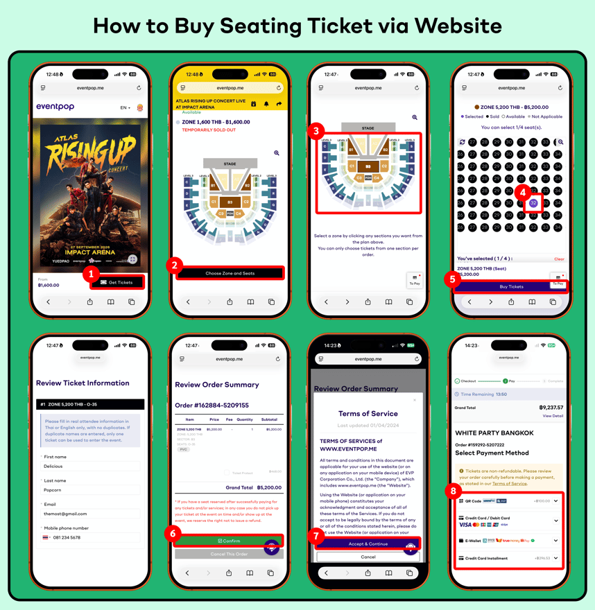

**หน้าจอ ENCORE ที่เกี่ยวข้อง**

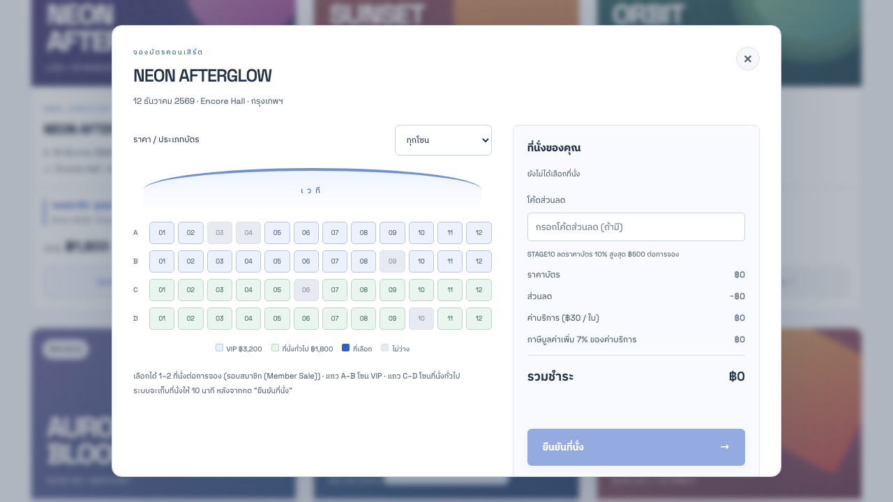

## REF10 · ภาพหน้ารอคิวก่อนซื้อบัตร

[Eventpop · ภาพขั้นตอนเข้าคิวจากคู่มือ](https://support.eventpop.me/en/queuing)

ใช้เทียบการแสดงหมายเลขคิวและสถานะก่อนเข้าซื้อ ภาพนี้มาจากคู่มือ ไม่ใช่คิวสด ENCORE ไม่ได้ใช้บริการ Queue-it หรืออีเมลแจ้งคิวตามต้นทาง และอายุสิทธิ์/สูตรรอเป็นกฎของ ENCORE

ข้อกำหนด: FR03 FR04 FR05 · กรณีทดสอบ: A11 A12 A13 A56 A59 U04 U19

**ภาพอ้างอิง**

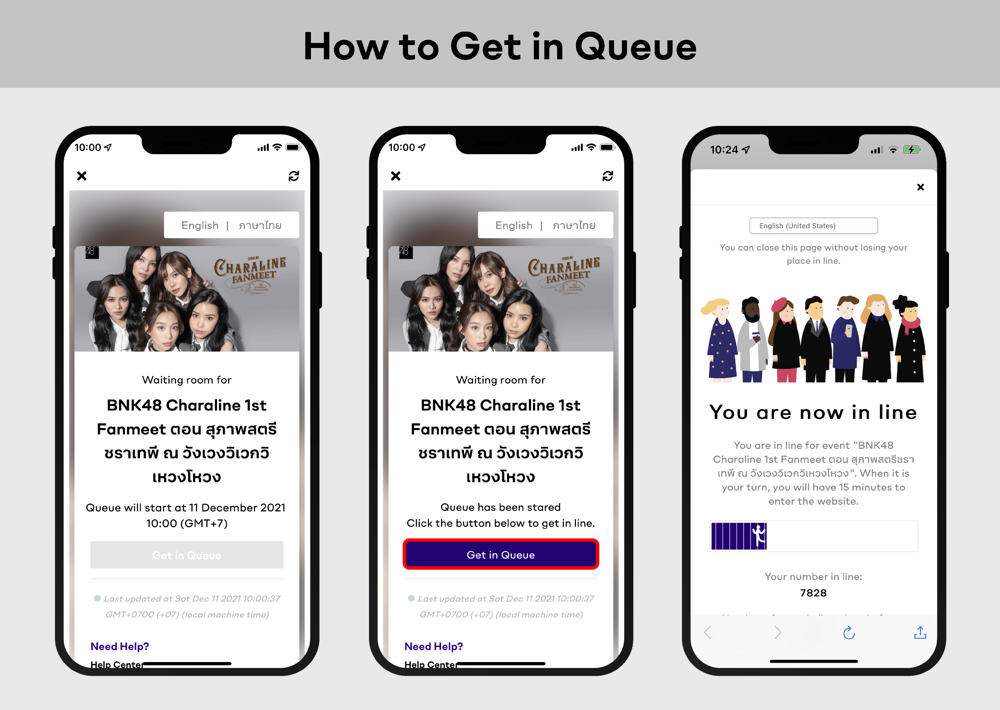

**หน้าจอ ENCORE ที่เกี่ยวข้อง**

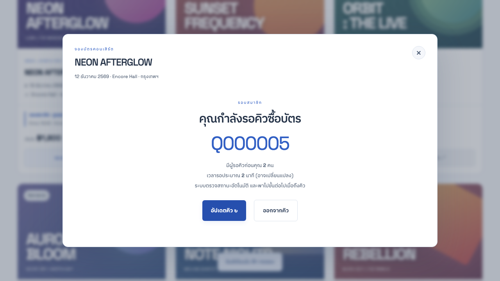

## REF07 · ค้นหาและเลือกคอนเสิร์ต

[Eventpop · หน้ารวมงาน](https://www.eventpop.me/)

ใช้แนวทางการ์ดงานที่แสดงโปสเตอร์ วันเวลา และสถานที่ ENCORE เพิ่มการแบ่งหน้า 6 งานและแยกรอบตามบัญชีตามโจทย์ผู้ใช้

ข้อกำหนด: FR02 FR07 · กรณีทดสอบ: A04 A44 U08 U15 U17

**ภาพอ้างอิง**

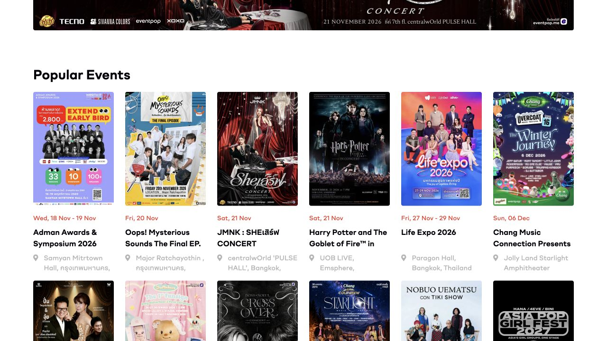

**หน้าจอ ENCORE ที่เกี่ยวข้อง**

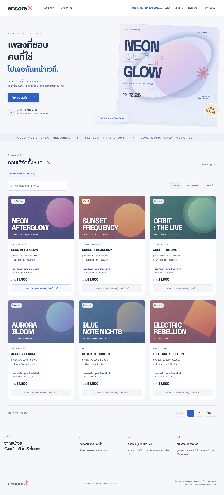

## REF08 · เข้าสู่ระบบก่อนซื้อบัตร

[Eventpop · หน้าต่างเข้าสู่ระบบ](https://www.eventpop.me/)

เทียบการแยกขั้นเข้าสู่ระบบจากการเลือกงาน ENCORE ใช้ชื่อผู้ใช้หรืออีเมลและรหัสผ่าน พร้อมบัญชีทดลองตามโจทย์ ไม่ได้รองรับการเข้าสู่ระบบด้วยผู้ให้บริการภายนอกเหมือนภาพต้นทาง

ข้อกำหนด: FR01 FR03 · กรณีทดสอบ: A01 A02 A03 A45 U02 U15 U16

**ภาพอ้างอิง**

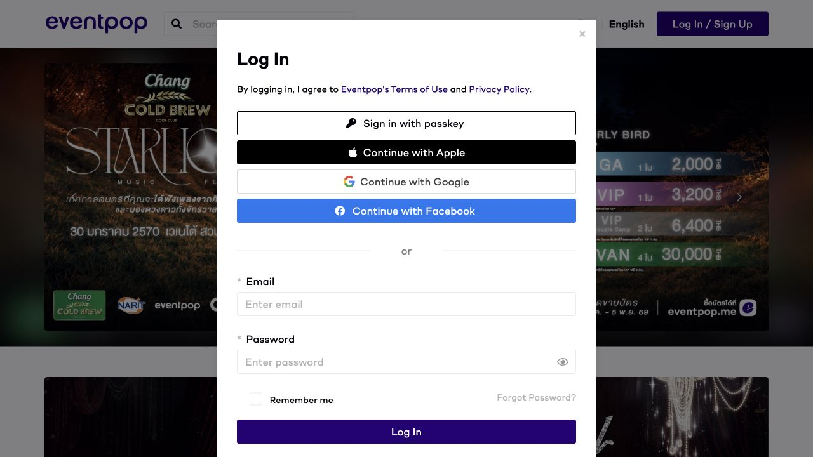

**หน้าจอ ENCORE ที่เกี่ยวข้อง**

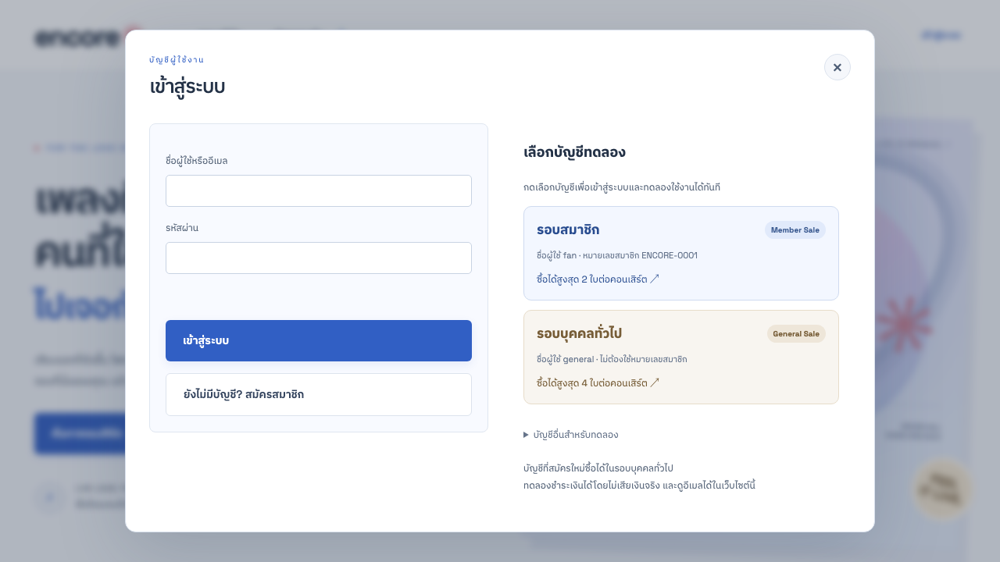

## REF02 · สิทธิ์ซื้อรอบสมาชิก

[Live Nation Tero · คู่มือ Presale](https://www.livenationtero.co.th/en/livenationteropresale)

ภาพเป็นหน้าคู่มือทางการ ไม่ใช่หน้าซื้อบัตรที่เข้าสู่ระบบแล้ว การกรอกหมายเลขสมาชิกและเพดาน 2 ใบเป็นกฎ ENCORE ที่ผู้ใช้กำหนด ไม่ใช่ข้อสรุปว่านโยบายต้นทางเหมือนกัน

ข้อกำหนด: FR02 FR03 FR05 FR06 FR08 · กรณีทดสอบ: A06 A07 A09 A10 A13 A14 A43 A44 U01 U10 U19

**ภาพอ้างอิง**

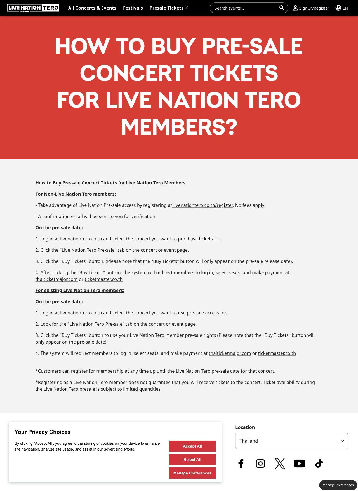

**หน้าจอ ENCORE ที่เกี่ยวข้อง**

## REF01 · รอคิวและเข้าซื้อเมื่อถึงคิว

[Ticketmelon · คู่มือระบบคิว](https://organizer.ticketmelon.com/help-center/how-does-the-queueing-system-work)

ภาพแสดงคำอธิบายขั้นตอนจากคู่มือ ไม่ใช่ภาพคิวสด ENCORE ใช้หมายเลขคิว จำนวนคนก่อนหน้า เวลารอโดยประมาณ และพาไปขั้นถัดไปอัตโนมัติ สูตรเวลาและจำนวนผู้ซื้อพร้อมกันเป็นสมมติฐานของระบบทดลอง

ข้อกำหนด: FR04 FR05 · กรณีทดสอบ: A11 A12 A56 A59 U04 U19

**ภาพอ้างอิง**

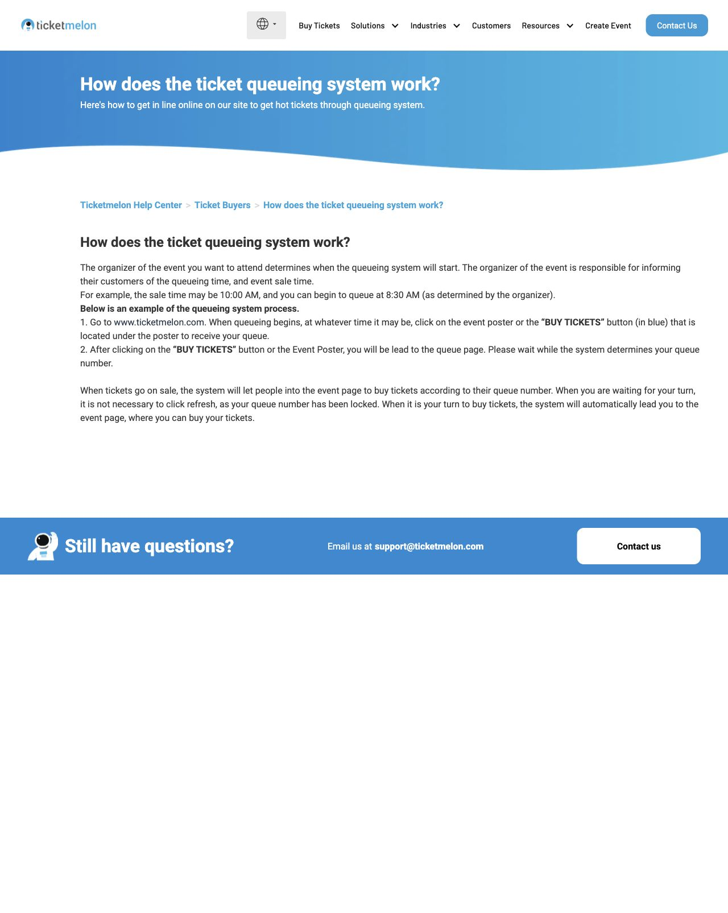

**หน้าจอ ENCORE ที่เกี่ยวข้อง**

## REF04 · คำแนะนำชำระเงินและรหัสอ้างอิง

[Ticketmelon · คู่มือ ATM / iBanking / Counter Service](https://organizer.ticketmelon.com/help-center/how-to-pay-with-atm-ibanking-counter-service)

ภาพประกอบจากคู่มือแสดงการตรวจยอดและใบอ้างอิง ENCORE ใช้แนวคิดรหัสอ้างอิงและเวลาหมดอายุ แต่ QR เป็นรหัสทดลอง ไม่โอนเงินจริง และไม่ได้เพิ่ม ATM/iBanking เป็นช่องทางใหม่

ข้อกำหนด: FR10 FR11 FR12 · กรณีทดสอบ: A22 A23 A24 A25 A26 A28 A29 A30 A47 A50 U11 U12 U13 U14 U24

**ภาพอ้างอิง**

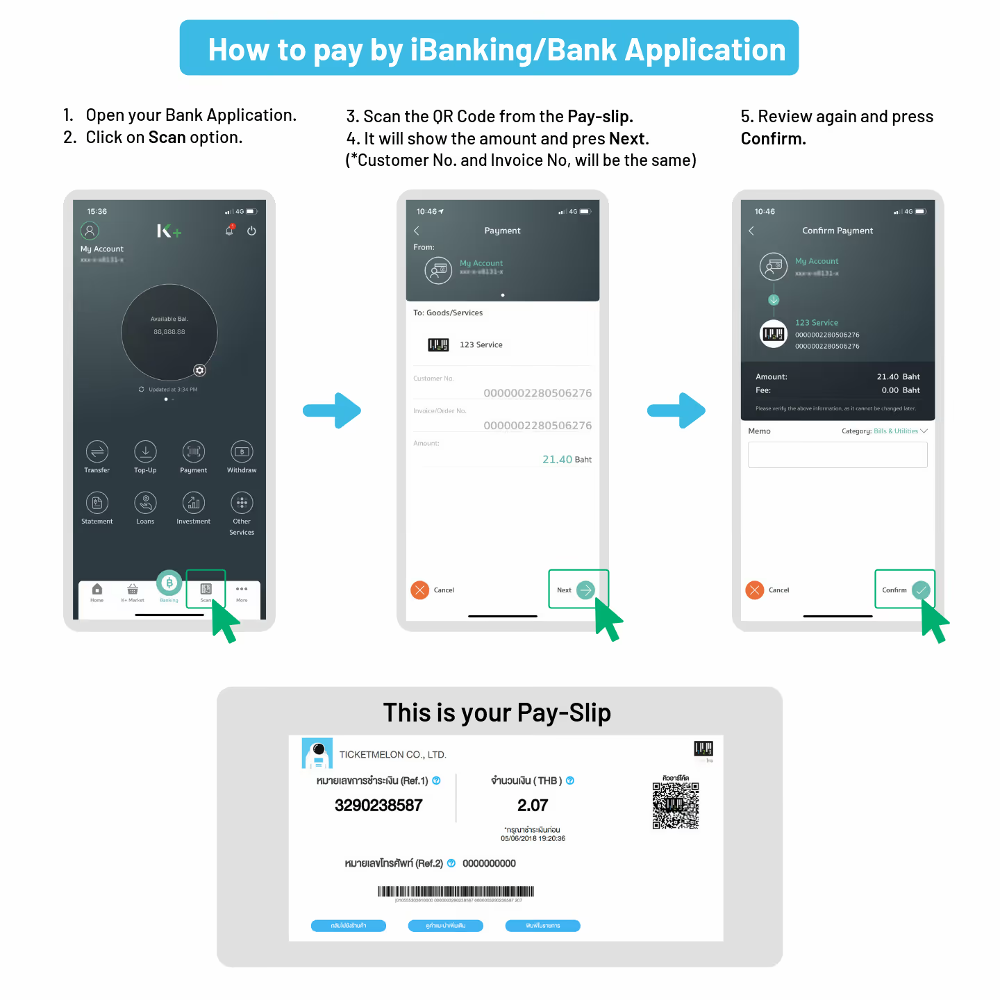

**หน้าจอ ENCORE ที่เกี่ยวข้อง**

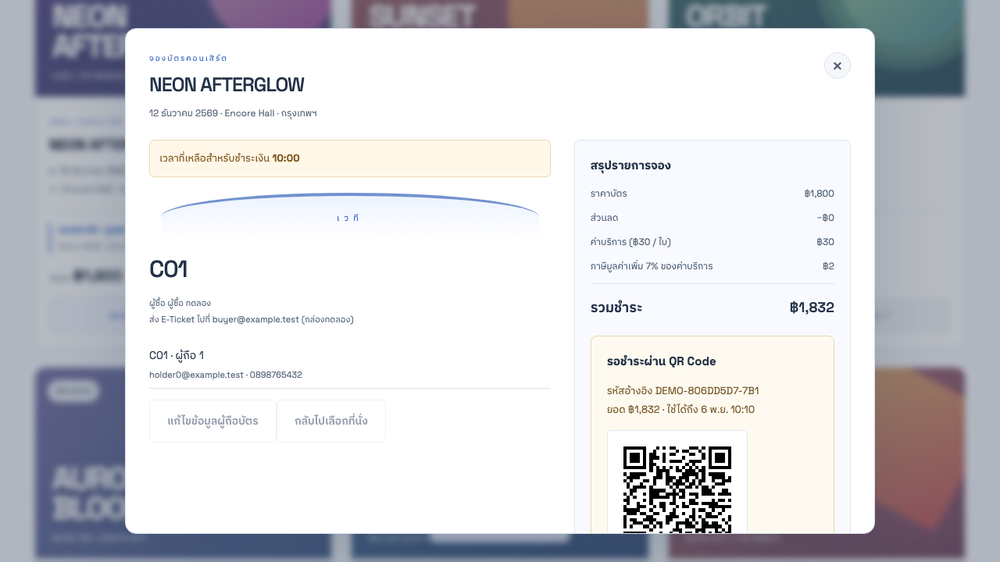

## REF05 · บัตรอิเล็กทรอนิกส์และข้อมูลผู้ถือบัตร

[Eventpop · คู่มือ E-Ticket](https://support.eventpop.me/en/how-to-download-and-use-e-ticket)

เทียบการแสดงชื่อผู้ถือ ข้อมูลงาน และ QR บนบัตร ENCORE แสดงบัตรในบัญชีและกล่องอีเมลทดลอง ตรวจรหัส QR ด้วยตัวถอดรหัสอิสระ และจำกัดการเข้าถึงตามเจ้าของ

ข้อกำหนด: FR09 FR13 FR14 FR15 FR16 · กรณีทดสอบ: A19 A20 A32 A33 A34 A36 A51 A55 A58 U01 U07 U16 U23 U24

**ภาพอ้างอิง**

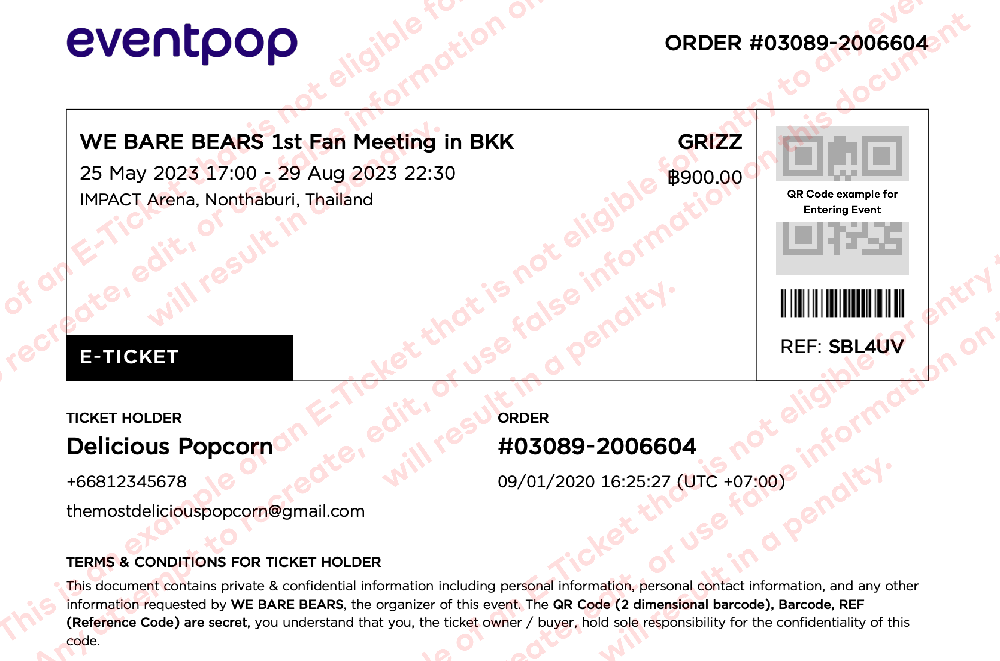

**หน้าจอ ENCORE ที่เกี่ยวข้อง**

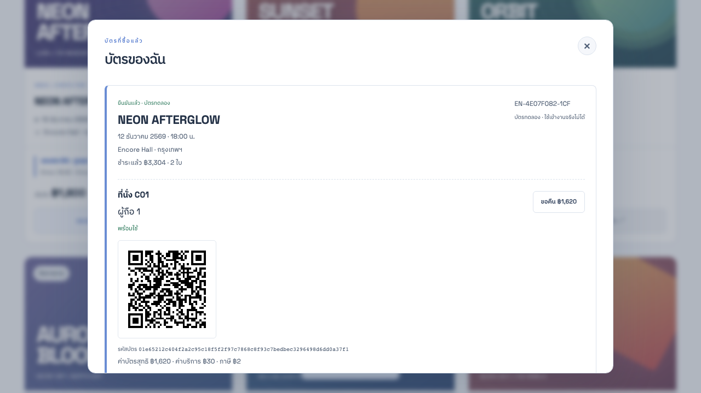

## ภาพประกอบเพิ่มเติมและข้อจำกัด

- [หน้าคู่มือชำระเงินเต็มหน้า](images/ticketmelon-counter-guide-page.jpg) และภาพต้นฉบับ AVIF เก็บไว้พร้อมสำเนา PNG สำหรับเปิดดูง่าย
- [หน้าคู่มือ E-Ticket เต็มหน้า](images/eventpop-eticket-guide-page.jpg) แสดงบริบทของภาพตัวอย่าง
- ไม่ได้เข้าสู่ระบบ ซื้อบัตร หรือเปิดคิวสดบนเว็บไซต์อ้างอิง ข้อมูลหลังเข้าสู่ระบบจึงอ้างอิงจากคู่มือสาธารณะเท่านั้น
- ภาพประกอบการชำระเงินอาจเป็นหน้าตาเวอร์ชันเก่าในคู่มือ ไม่ใช้ยืนยันว่าหน้าชำระเงินปัจจุบันเหมือนภาพ และไม่ใช้ช่องทางหรือเลขอ้างอิงในภาพกับระบบ ENCORE
- ThaiTicketMajor เคยตอบ 403 ในการสำรวจเดิม จึงยังไม่มีภาพหน้าจอที่ยืนยันได้ และไม่นำภาพสร้างขึ้นมาแทนภาพจริง
