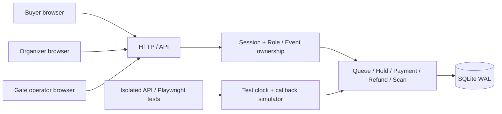
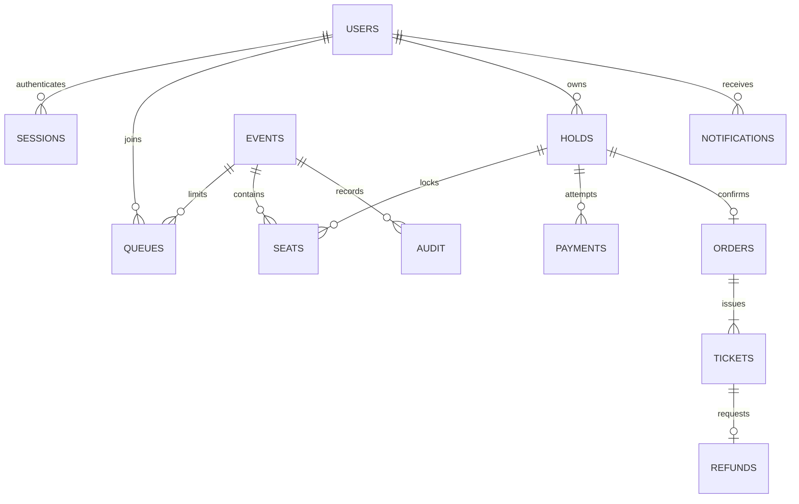
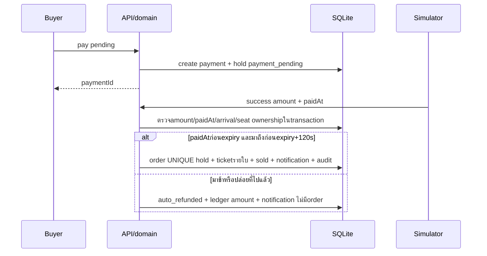
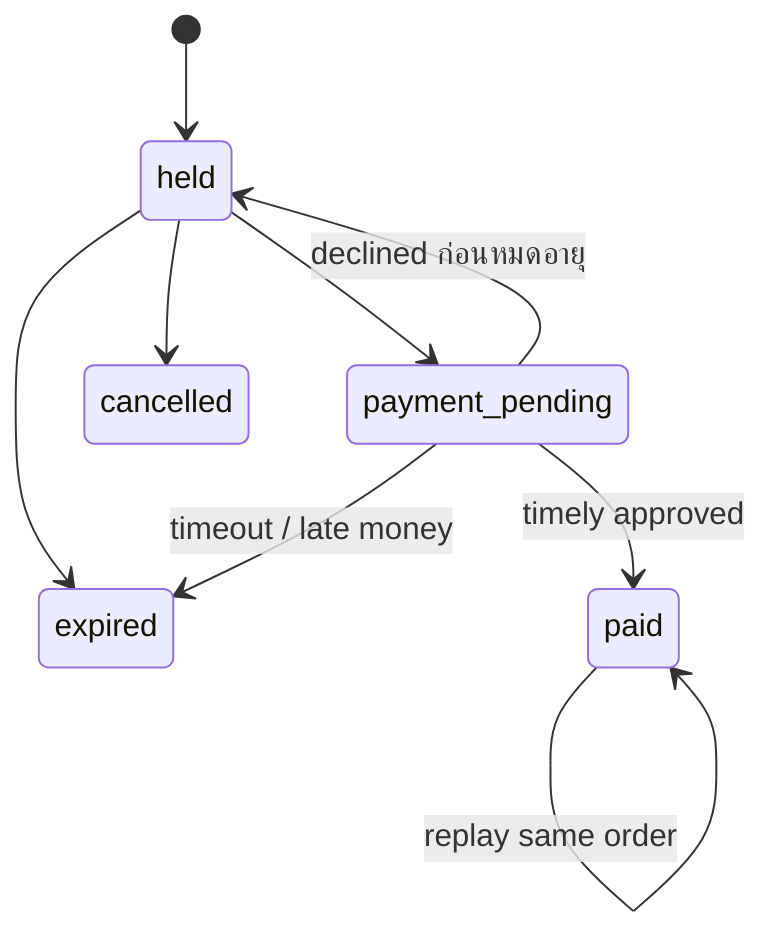
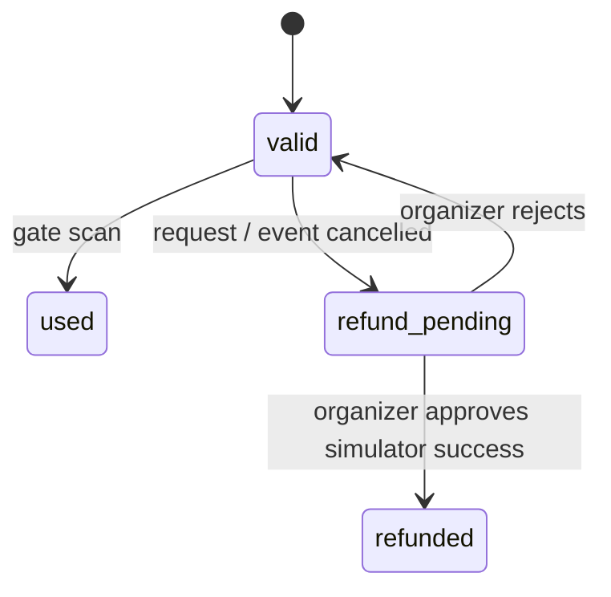

# System Design — ENCORE V2

Node built-inHTTP เสิร์ฟUIและJSONAPI, node:sqlite + WAL เก็บข้อมูลหนึ่งไฟล์; ส่วนทดสอบใช้in-memory/temporaryDB ไม่มีบริการภายนอก

## แบ่งไฟล์
- store.mjs: schema, fixture, salted scrypt, parameterizedSQL, clock และtransactionhelper
- domain.mjs: กฎธุรกิจและatomicwrite ทุกhold/payment/refund/scan/controlอยู่BEGIN IMMEDIATE ไม่มีawaitภายใน
- server.mjs: HTTP/input/origin/session/RBAC-routing; testtools gated; bind127.0.0.1
- public/: catalogและdialog auth/queue/booking/tickets/inbox/admin/scanner; userinputเป็นtextContentหรือescapeHTML

## โครงสร้างข้อมูล

usersเก็บroleและpresaleentitlement; eventsเก็บowner/state/currentroundและfixturedata; seatsคีย์(event,id); queuesมีseqเรียงFIFO; orders.hold UNIQUE; ticket.code UNIQUE; refund.ticket UNIQUE (ปฏิเสธแล้วขอใหม่ใช้recordเดิม); paymentหลายattemptต่อholdแต่มีpendingได้หนึ่งตัวผ่านtransaction
sessionเก็บSHA256digestของtoken256bit; passwordเก็บsalt+scrypt64bytes; ไม่มีpassword/tokenบัตรในaudit

## คิวและการถือที่
1. สมาชิกjoinqueueที่งานเปิดขาย; activeสูงสุด2คนจากwaitingseqต่ำสุด
2. reserveตรวจactivequeue, currentround, presale, availability, quota, priceในtransaction
3. เปลี่ยนbasketเดิมแบบatomic; pendingห้ามreplace; โควตานับticketsที่ยังไม่refundedรวมกับbasketใหม่
4. hold600sจากserver; การreloadไม่เพิ่มเวลา; sweepก่อนทุกAPIอ่าน/เขียน ปลดexpiredholdsและqueues
5. Nodeหนึ่งprocessทำwriteแบบsyncและSQLitewrite-lockป้องกันแข่งกัน ผลทดสอบ10buyerมี2คนผ่านqueueเข้าแข่งที่และ8คนโดนqueueปฏิเสธ ไม่ใช่loadtestหรือdistributedqueue

## Payment ที่รอผล

Testcallbackตั้งamount/paidAtได้เฉพาะtesttoken ส่วนปุ่มresolveจำลองปกติใช้amount/nowจากserver ไม่ใช่externalwebhookจริง เมื่อdeclinedretryสร้างpaymentIdใหม่ terminalattemptเก่าเปลี่ยนผลไม่ได้
pendingtimeoutตรงexpiry+120sปล่อยที่; successที่ตามมาคืนเงินจำลองแม้paidAtเดิมถูกเวลา ไม่แย่งที่นั่งที่ขายใหม่

## สถานะ

## Refundและยอดเงิน
Ticketเก็บnet/fee/vatจากsnapshotที่hold; allocationใช้largest-remainderกำหนดtieตามseatId; sumticketต้องเท่ากับorder
voluntaryคืนnet; eventcancelคืนnet+fee+vat; refund_pendingพักสิทธิ์; approvedคืนseat/โควตาและลงledgerในtransactionเดียว; rejectคืนvalid; auditไม่เพิ่มซ้ำเมื่อapproveซ้ำ
Dashboardgrossรวมpaymentssucceededที่มีorder; refundรวมrefundssucceeded; net=gross−refund; เงินมาช้าที่ไม่ออกorderเก็บในpayment.refund_amountแยก ไม่ทำให้netของยอดขายติดลบ

## สิทธิ์และขอบเขต
serverตรวจownerทุกadminendpoint, scannerเฉพาะneonตามfixture, buyerเฉพาะhold/order/ticketตัวเอง คำขอผิดresourceของbuyerตอบ404 เพื่อลดการเปิดเผยรหัส
V2แยกDBจากV1โดยไม่migrateguestorderเป็นบัญชี การทดสอบrestartพิสูจน์ข้อมูลคงอยู่ของV2
ไม่มีgatewayจริง/emailจริง/กล้องQR/queueหลายnode/การเผยแพร่ออนไลน์/การสร้างงานใหม่ผ่านUI การขยายproductionต้องออกแบบintegrationและปฏิบัติการเพิ่มเติมตามโจทย์จริง
