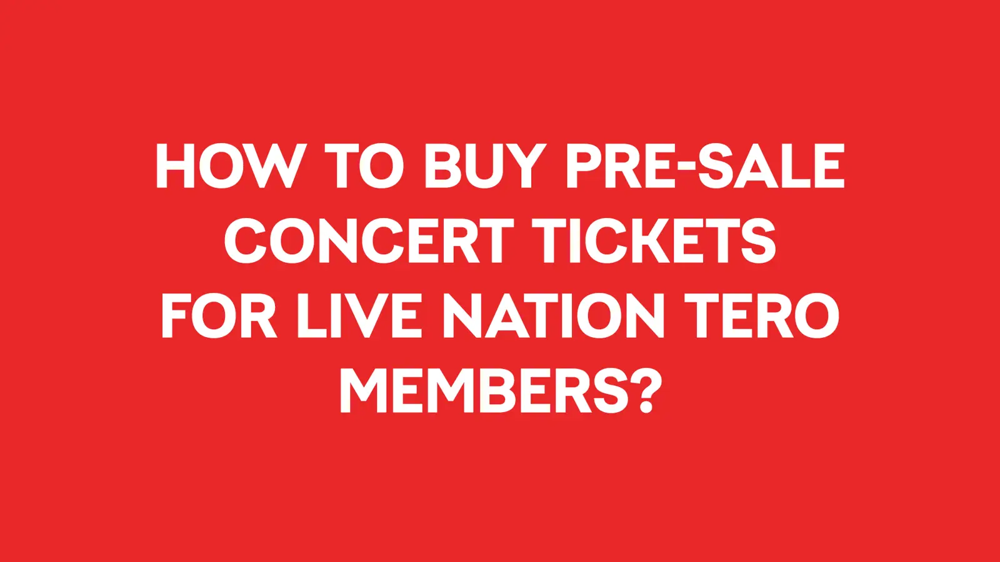
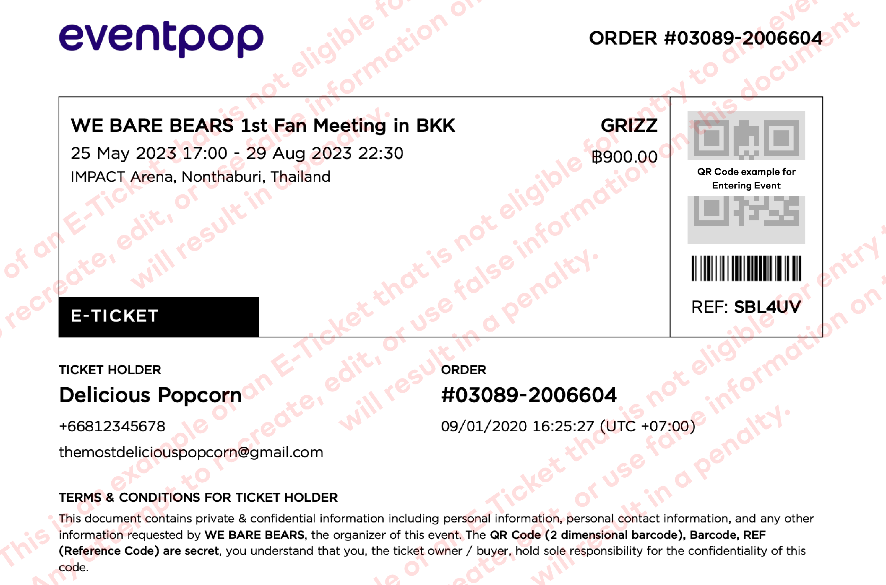

# Reference Library — ENCORE V3

เข้าถึง 6 พฤศจิกายน 2569 แหล่งทางการเท่านั้น ใช้เพื่อวิเคราะห์ประสบการณ์ ไม่คัดลอกแบรนด์หรืออ้างเป็นนโยบายของENCORE ภาพเป็นของเจ้าของเว็บไซต์และใช้เป็นเอกสารอ้างอิงภายใน ไม่ใช่ภาพระบบที่เราสร้าง

| Ref | แหล่ง / ลิงก์ | สิ่งที่นำมาพิจารณา | Requirement |
|---|---|---|---|
| REF01 | [Ticketmelon Queue Guide](https://organizer.ticketmelon.com/help-center/how-does-the-queueing-system-work) | เข้าคิวจากงาน เห็นหมายเลขและรอเข้าซื้อเมื่อถึงคิว | V3-FR03/04 |
| REF02 | [Live Nation Tero Presale](https://www.livenationtero.co.th/en/livenationteropresale) | ต้องloginและมีสิทธิ์ก่อนซื้อรอบสมาชิก การเป็นสมาชิกไม่รับประกันบัตร | V3-FR02/05/06 |
| REF03 | [Ticketmelon Payment Methods](https://organizer.ticketmelon.com/ticket-buyers) | แยกช่องทางบัตร/QR/Alipay/Counter และสถานะชำระ | V3-FR11/12 |
| REF04 | [Ticketmelon Counter Service Guide](https://organizer.ticketmelon.com/help-center/how-to-pay-with-atm-ibanking-counter-service) | แสดงคำแนะนำ/รหัสอ้างอิงก่อนชำระที่เคาน์เตอร์ | V3-FR11/12 |
| REF05 | [Eventpop E-Ticket](https://support.eventpop.me/en/how-to-download-and-use-e-ticket) | บัตรมีข้อมูลผู้ถือ QR และดูได้ทั้งในบัญชีกับอีเมล | V3-FR13/14/15 |
| REF06 | [Ticketmelon E-Ticket Entry](https://organizer.ticketmelon.com/help-center/how-to-enter-the-event-using-e-ticket) | ใช้QRจากบัตรในบัญชีหรืออีเมลเพื่อแสดงเข้างาน | V3-FR13/16 |

## ภาพจากแหล่งอ้างอิง

REF02: [ต้นฉบับภาพ](https://networksites.livenationinternational.com/networksites/yijnlsik/buyps-lnt-en.jpg?format=webp&width=1600&quality=75) เก็บเพื่อดูflowตรวจสิทธิ์ ไม่อ้างว่าเป็นหน้าENCORE

REF05: [ต้นฉบับภาพ](https://d33v4339jhl8k0.cloudfront.net/docs/assets/5b877b082c7d3a03f89e447c/images/643fc0037133de139103ede1/file-pd10nJUbkU.png) ใช้ดูตำแหน่งชื่อ/ข้อมูล/QRเท่านั้น ห้ามนำรหัสจากภาพไปใช้เป็นบัตรของระบบ

## การตัดสินใจ
ข้อกำหนดผู้ใช้[U]มาก่อนแหล่งอ้างอิง[R] เช่น Member10:00/General15:00, 2ใบต่อuser, ข้อความ“ไม่ใช่สมาชิกMember” และสี่ช่องทางที่ระบุ เป็นกฎENCOREจากคำสั่งผู้ใช้ ไม่ได้อนุมานว่านโยบายทุกเว็บเหมือนกัน
การรอโดยประมาณเป็นสมมติฐาน[A]ของระบบทดลอง ไม่รับประกันเวลาจริง ค่าธรรมเนียมและนโยบายของเว็บอ้างอิงไม่ถูกนำมาใช้แทนสูตรเงินเดิม

## UI mood update
ผู้ใช้ขอแนวเว็บขายบัตรสบายตาคล้าย[Eventpop](https://www.eventpop.me/) และ[ThaiTicketMajor](https://www.thaiticketmajor.com/) จึงปรับพื้นสว่าง สีฟ้านุ่ม และโปสเตอร์ลดความจัดโดยออกแบบเอง หน้าEventpopเปิดอ่านได้ ส่วนหน้าแรกTTMตอบ403ในการตรวจครั้งนี้ จึงไม่อ้างว่าได้คัดหน้าจอปัจจุบันของTTMมาแล้ว
